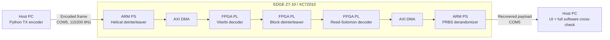

# LDACS Receiver on EDGE Z7-10

An end-to-end LDACS receiver demonstrator built around the **EDGE Z7-10** and
its **XC7Z010CLG400-1** Zynq-7000 SoC. It combines a Python reference chain,
ARM-side processing, FPGA decoder RTL, a UART bridge, a Vivado build flow, and
a small web console that reports data returned by the physical board.

> **Current result: hardware integration validated, spec conformance NOT
> validated.**

The design has been synthesized, implemented, programmed, and exercised through
the board USB-UART on `COM5`. The zero-error loopback validates the real
PC-to-PS-to-PL-to-PS-to-PC path. It cannot independently establish the
correctness of constants marked `SPEC-CHECK`, because the transmitting model and
the receiving implementation use the same assumptions.

## Why this repository matters

This is a practical, inspectable hardware/software implementation—not a screen
mock-up. A message sent through the console is encoded on the host, sent to the
Zynq over UART, processed by the ARM and FPGA, and returned over the same UART.
The web interface only displays returned board data, real Vivado utilization,
and measured transaction timing.

The implementation follows the receiver partition described by Kurz *et al.*,
*High Performance Implementation of Next Generation Aeronautical Communication
Systems*, IEEE OJIES, 2022. The project deliberately does **not** claim
specification conformance until independent vectors resolve the marked
assumptions.

## Architecture



### Decoder-stage mapping

| Receiver stage | Execution domain | Main implementation |
| --- | --- | --- |
| Helical deinterleaver | Zynq ARM PS | `sw/src/helical.c` |
| Viterbi decoder | FPGA PL | `hw/rtl/viterbi_dec.v` |
| Block deinterleaver | FPGA PL | `hw/rtl/block_deint.v` |
| Reed-Solomon decoder | FPGA PL | `hw/rtl/rs_dec.v` |
| PRBS derandomizer | Zynq ARM PS | `sw/src/derand.c` |

The host-side encoder and complete Python receiver are in
`model/ldacs_ref.py`. Each live hardware response is separately compared with a
complete software decode of the exact frame sent to the board.

## Real build and board evidence

The latest routed XC7Z010 implementation reports:

| Metric | Measured value |
| --- | ---: |
| Implemented PL clock | 71.429 MHz |
| Worst negative slack | +0.330 ns |
| Total negative slack | 0.000 ns |
| Slice LUTs | 11,031 / 17,600 (62.68%) |
| Slice registers | 5,788 / 35,200 (16.44%) |
| Block RAM tiles | 50.5 / 60 (84.17%) |
| DSPs | 1 / 80 (1.25%) |

The full eight-mode COM5 sweep recovered every payload exactly, with zero
hardware byte/bit mismatches, zero RS failures, and zero hardware-versus-
software byte mismatches. The detailed build output, transaction evidence,
limitations, and parsed report lines are recorded in
[`HARDWARE_STATUS_SUMMARY.md`](HARDWARE_STATUS_SUMMARY.md).

### Measurement boundary

The measured `0.005–0.007 Mb/s` and `0.9–2.8 s` values are complete
UART-to-UART host transactions. The present bridge sends coded bits as UART
bytes at 115200 baud, so those numbers are transport-limited; they are **not**
an internal FPGA decoder-throughput measurement. Individual PS/PL stage timing
needs hardware counters, an AXI timer, or ILA instrumentation.

## Repository map

| Path | Purpose |
| --- | --- |
| `board_details/` | Checked-in EDGE Z7-10 board definition used by Vivado. |
| `hw/rtl/` | Synthesizable decoder RTL and AXI-stream/control wrapper. |
| `hw/tb/` | HDL testbench. |
| `hw/vivado/` | Project-generation and implementation Tcl scripts. |
| `sw/` | Bare-metal ARM UART bridge and PS-side functions. |
| `model/` | Python reference encoder/decoder and live hardware engine. |
| `web/` | Measured-data-only transmitter and receiver console. |
| `scripts/` | Repeatable simulation and software validation utilities. |
| `docs/` | Setup notes and the explicit assumptions register. |

## Fresh environment setup

### 1. Host prerequisites

- Windows with Vivado/Vitis **2022.2** installed (the verified run used this version).
- Python 3.10+.
- `arm-none-eabi-gcc`, normally supplied by Vitis.
- USB-JTAG connection to the EDGE Z7-10 and its USB-UART enumerated as `COM5`.

```powershell
git clone https://github.com/Mithunjagan/LDACS.git
cd LDACS
python -m venv .venv
.\.venv\Scripts\Activate.ps1
python -m pip install -r requirements.txt
```

If Windows assigns another serial port, update `COM_PORT` in
`model/ldacs_engine.py` before running the console.

### 2. Build the FPGA project and bitstream

The project uses the checked-in board definition; no Vivado board-catalog edit
is required.

```powershell
cd hw\vivado
vivado -mode batch -source create_project.tcl
vivado -mode batch -source build.tcl
cd ..\..
```

Expected generated artifacts:

```text
hw/vivado/build/ldacs_zed/ldacs_zed.runs/impl_1/system_wrapper.bit
hw/vivado/build/ldacs_zed.xsa
hw/vivado/build/timing.rpt
hw/vivado/build/utilization.rpt
```

### 3. Build and boot the ARM firmware

```powershell
python build_firmware.py
xsdb.bat boot_firmware.tcl
```

The boot script initializes the Zynq PS from the generated board preset,
programs the FPGA bitstream, loads `sw/uart_bridge.elf` into DDR, and starts the
ARM core.

### 4. Run the live console

```powershell
python server.py
```

Open either page in a browser:

- `http://localhost:8000/tx/index.html` — send a message through hardware.
- `http://localhost:8000/rx/index.html` — inspect the most recent board result.

## Testing workflow

### Deterministic software validation

```powershell
python scripts/validate_software_modes.py
```

This encodes and decodes one deterministic full frame for all eight modes. A
passing run reports `8/8 modes passed` with zero RS failures.

### RTL simulation

With Icarus Verilog available:

```bash
./scripts/run_sim.sh quick
./scripts/run_sim.sh
```

### Real hardware transaction

1. Boot the board with `xsdb.bat boot_firmware.tcl`.
2. Start `python server.py`.
3. In the Transmit page choose a mode, enter a message, and select **Send through hardware**.
4. Confirm all three checks: hardware vs input, hardware vs software, and RS status.

The result must be marked successful only when a framed response was actually
received from `uart_bridge.elf`; the server does not substitute a software
result when hardware is unavailable.

## Debugging guide

| Symptom | Check | Likely corrective action |
| --- | --- | --- |
| Web page does not open | `http://localhost:8000/tx/index.html` | Run `python server.py`; ensure port 8000 is free. |
| `COM5 unavailable` | Windows Device Manager and board power | Verify USB-UART connection; update `COM_PORT` if Windows assigned a different port. |
| `ERR_NO_TARGET` during boot | JTAG cable and board power | Reconnect JTAG and confirm the target identifies as `xc7z010`. |
| `ERR_NO_BIT` or `ERR_NO_PS7_INIT` | Vivado build artifacts | Re-run `create_project.tcl`, then `build.tcl`. |
| Timing or fit fails | `hw/vivado/build/timing.rpt`, `utilization.rpt` | Treat this as a build failure; do not program it as a validated image. |
| Large-frame decode failure | Viterbi capacity and BRAM mapping | The checked-in design uses a 22,016-step, banked decision memory; rebuild after RTL changes. |

## Design notes and open work

- `SPEC-CHECK` markers remain in source for the helical permutation,
  `HELICAL_ROWS`, block-interleaver geometry, PRBS seed, and polynomial.
  Independent specification-derived vectors are needed before closing them.
- This project validates a receiver loopback, not an RF link. OFDM
  synchronization, channel estimation, demapping, and an RF front end are not
  included.
- Add on-board cycle counters or AXI timer instrumentation to measure each
  PS/PL stage independently.
- Replace the byte-per-coded-bit UART protocol with a higher-bandwidth transport
  for a meaningful end-to-end throughput measurement.
- Add independent LDACS test vectors and controlled error campaigns to test
  correction capability and the remaining marked assumptions.
- The Viterbi decision store consumes most available BRAM. A sliding-window
  traceback is the next major resource optimization.

## Board reference

The checked-in `board_details/edgeZ7_10/A.0` files are the verified local copy
of the EDGE Z7-10 board definition. Their upstream sources are the
[EDGE ZYNQ SoC FPGA Development Board User Manual](https://allaboutfpga.com/edge-zynq-soc-fpga-development-board-user-manual/)
and [AllAboutFPGA EDGE FPGA Kit Board Files](https://github.com/AllAboutFPGA/EDGE-FPGA-Kit-Board-Files).

## License and contribution

No license file was supplied with the original workspace. Add an explicit
license before accepting external contributions. Please keep generated Vivado
outputs, local serial captures, and credentials out of commits.
